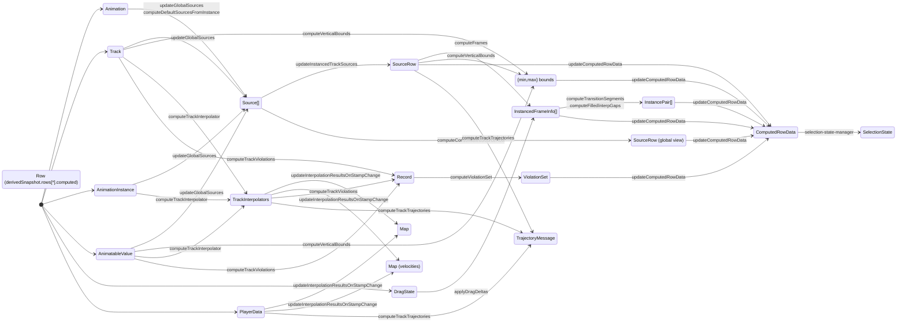

# @semio/animation Documentation

`@semio/animation` supplies the shared animation timeline, selection, and gesture system used across Semio surfaces. The package exposes React components (timeline HUD, track controls, playback widgets), the zustand store that powers them, helper actions for manipulating animation data, and a suite of utilities for rendering and validating animated motion.

This document captures the current organization, data structures, and runtime flow of the library. Pair it with the root `AGENTS.md` and `packages/animation/AGENTS.md` when planning new work.

## Package Anatomy

| Path | Purpose | Notes |
| --- | --- | --- |
| `src/index.tsx` | Package entry point | Re-exports public components, hooks, store helpers, actions, utilities, and test fixtures. Keep this file authoritative for public API shape. |
| `src/components/` | React components for the animation sheet, controls, HUD, and visualization widgets | Split into focused sub-folders (`animation-sheet`, `controls`, `canvas-sheet`, etc.). Components consume the zustand store via hooks and context. |
| `src/actions/` | Pure Immer reducers mutating `AnimationData` | Includes creation/update/removal of animations, tracks, keypoints, color controls, and drag orchestration (`actions/drag/*`). All mutations flow through these helpers. |
| `src/functions/` | Pure computation helpers and derived data builders | Houses frame interpolation, source-tree management, drag math, virtual frame generation, selection-state helpers, and rendering-specific transforms. |
| `src/hooks/` | React hooks for interacting with the store, gestures, and rendering primitives | Includes gesture bindings (`use-drag-gestures`, `use-zoom-gestures`), spring helpers, player integration, and selectors (`use-animation-store`). |
| `src/subscriptions/` | Store subscriptions registered at init | Maintain derived state (interpolators, computed rows, global sources), synchronize with the shared player store, and clean up via unsubscribe handles. |
| `src/store.ts` | zustand store slice factory | Composes `AnimationData` state with `AnimationActions`, wires Immer-based updates, and bootstraps subscriptions. |
| `src/store-types.ts` | Canonical types for store state and actions | Documented source of truth for the data model. Update alongside behaviour changes. |
| `src/types/` | Domain types for animations, sources, views, and drag state | Structured by `data/` and `util/` folders; heavily referenced by consumer apps. |
| `src/test-fixtures/` | Reusable sample animations/tracks | Use these when adding Vitest coverage or Storybook scenarios. |
| `src/tests/` | Vitest suites (currently commented while refactors land) | Re-enable/update when functionality becomes active. |
| `docs/` | Architecture and migration notes | Add supplementary deep dives here; keep this README as the high-level map. Prune/merge supplementary deep dives when no longer relevant or outdated. |

## Migration Plans

- [ ] [Selection State Migration](./selection-migration.md)
- [ ] [Canvas Sheet Layering & Contrast Migration](./canvas-sheet-layering-migration.md)
- [ ] Centralize test microtask flushing by adding a shared helper (e.g., `flushMicrotasks`) and replacing `setTimeout`-based waits in tests
- [x] Adopt normalized derivedSnapshot across components; gate selectors on derivedSnapshot.version
- [x] Wire drag preview to derived snapshot; ensure commit paths update canonical and orchestrated derived state

## Core Data Model

The zustand store (`AnimationData` in `store-types.ts`) is the single source of truth for canonical data. A normalized derived snapshot is produced by the orchestrator for rendering. Key fields:

- `values` / `velocities`: `Map<string, RawValue>` keyed by namespace-qualified IDs describing the sampled value/velocity at the current stamp. Updates propagate to the player and consuming apps.
- `trackInterpolators`: Cache of active interpolators (`TrackInterpolators`) used to sample values and detect violations.
- `namespaces`: Namespaced animation instances keyed by ID. Encodes instance/group relationships so overlapping tracks do not stomp each other.
- `animations` / `tracks`: Canonical animation metadata (`StoredAnimation` + `Track<RawValue>`) loaded in the editor. Tracks reference keypoints and interpolator configuration.
- `selectionState`: Path-based selection record managed via `functions/selection-state-manager.ts`. Replaces the earlier point-array selection.
- `previews`: Semantic time markers (`Preview`) for scrubbers, hover, etc.
- `dragState`: Structure describing in-progress virtual drag operations, including original keypoint positions and offsets.
- `editorViews`: Multi-window configuration (see `types/util/view.ts`) capturing view mode, active source rows, and layout preferences.
- `sourcesByAnimationInstance` / `instancedTrackSources`: Hierarchical representation of animation data grouped by animation, namespace, and instance.
- `sourceRowIds`: Global order of visible rows for views; per-row computed data is read from `derivedSnapshot.rows[rowId].computed`.
- `violations`: Track-level validation results (e.g., interpolation or constraint issues).
- `preferences`: UI toggles (hover dashed line, data previews) synced with consuming apps.
- `animatables`: Temporary bridge storing legacy animatable metadata during migration.
- `derivedSnapshot`: Normalized view (track cache feeding row/selection views) including per-track caches, `rows`, and precomputed aggregates used by the UI and Storybook during both steady state and drag preview.
- `derivedSnapshot.version`: Monotonic version bumped by the derived-state orchestrator; selectors can subscribe to this to avoid subtle stale reads when multiple derived subsets update in one tick.

Updates to these structures should go through the corresponding actions and pure helpers—avoid direct mutations in components.

### Canonical vs. Derived State

- Canonical state lives in `AnimationData` (animations, tracks, instances, selection, `dragState`, preferences).
- Derived state is computed, not stored: interpolators, row/computed data, values/velocities, violations. It is materialized into a normalized `derivedSnapshot` so the UI can read a consistent view across many subscribers.
- Equality guards (shallow or deep) alone can’t fix cross-slice staleness because multiple derived subsets may update in different microtasks; the orchestrator batches updates and bumps `derivedSnapshot.version` once so subscribers see a coherent frame.

## Actions & Mutations

All state changes flow through the `src/actions` layer. Notable groups:

- **Animation lifecycle**: `addAnimation`, `removeAnimation`, `createNewDefaultAnimation`, `setAnimations`, `getStorableAnimation` (with serialization logic in `functions/compute-stored-animation.ts`).
- **Track & keypoint editing**: `createTrack`, `updateTrack`, `removeTrack`, `createKeypoint`, `updateKeypoint`, `removeKeypoint`, plus batch variants for multi-edit operations. These functions ensure track metadata stays in sync with `animations[...]`.
- **Selection & gestures**: `clickMarker` coordinates modifier-key behaviour and ties into the selection state. Drag-specific actions (`startDragging`, `updateDragDelta`, `commitDrag`, `cancelDrag`) maintain ID-based selections, update virtual frames, and resample values through helper functions such as `apply-drag-offsets.ts`.
- **Preferences**: `setPreferences` maintain UI-specific metadata while keeping mutations pure.

Each action assumes Immer-managed drafts—pass the zustand state into the helper instead of mutating directly.

### Event Timeline (Drag → Commit)

During drag (preview):
- `startDragging` marks selected items and seeds `dragState` with originals and offsets.
- `updateDragDelta` updates virtual frames only; canonical tracks/keys are not mutated.
- The derived orchestrator recomputes preview projections (frames, bounds, transition segments, computed row data) and interpolators as needed, publishing a new `derivedSnapshot` and bumping `derivedVersion` so UI renders a consistent preview.

On commit (`commitDrag`):
- Apply offsets to canonical keypoints/tracks in `animations`/`tracks`.
- Clear `dragState` and trigger a full orchestrator pass so interpolators, values/velocities, violations, and row computations align with the committed state.
- Consumers that select by `derivedSnapshot.version` transition seamlessly from preview to committed renders.

## Derived State & Subscriptions

`initAnimationSubscriptions` registers long-lived observers (see `src/subscriptions`):

- `updatePlayerLoop` and `updateOverallDuration` keep the global player (`@semio/utils`) aligned with sheet bounds and duration changes.
- `updateAllInterpolatorsAndResultsOnDataChange` and `updateInterpolationResultsOnStampChange` recompute `values`, `velocities`, and `trackInterpolators` as data or playback stamp changes.
- `updateInstancedTrackSources`, `updateGlobalSources`, `updateSourceRowIds`, and `updateConsolidatedSourceRow` build the canonical inputs for rows. The snapshot orchestrator (`initDerivedOrchestrator`) computes `derivedSnapshot` and projections consumed by sheet components and Storybook demos.

Subscriptions return teardown functions; `initAnimationSubscriptions` wires the orchestrator and input subscriptions and defers registration to avoid cascading updates during initial store creation.

The derived-state orchestrator coordinates consistent recomputation:
- Signature detection: hash the canonical inputs that affect derived state; skip work if unchanged.
- Phases: recompute `trackInterpolators` → `violations` → `computedRowData` (rows) → `values`/`velocities` for the current stamp; reuse `existingDerived` caches where possible to minimize churn.
- Fire semantics: a `fireImmediately` flag is used for first-run and when high-priority events (drag start, player-stamp change) occur to prevent double paints.
- Versioning: after applying the minimal set of updates, bump `derivedSnapshot.version` exactly once so subscribers observe a coherent snapshot.

## Data Flow Overview

## Normalized Derived Snapshot

Schema overview:
- TrackKey: stable identifier that uniquely addresses a track within an animation instance/namespace.
- DerivedTrack: per-track cache including interpolator references, last-computed frames, and violation summaries.
- DerivedRow: UI row projection containing sources, instanced frames, transition segments, vertical bounds, and computed aggregates used by controls and canvas.
- DerivedSnapshot: `{ tracks: Record<TrackKey, DerivedTrack>, rows: Record<string, DerivedRow>, version: number }` produced atomically by the orchestrator. Selectors should read `derivedSnapshot.version`.

Computation phases:
- Inputs: global/instanced sources and canonical track metadata
- Build/refresh per-track interpolators and caches
- Compute per-row frames, bounds, transition pairs, and consolidated/global rows
- Assemble the snapshot and publish by bumping `derivedVersion`

Migration path:
- Prefer selectors that read from `derivedSnapshot.rows[...]` instead of ad-hoc helpers.
- Migrate any component reading interpolators/values directly to select via `derivedVersion` and the normalized caches.

## Rendering Surface

- `AnimationSheet` / `AnimationSheetCore` compose the timeline UI (headers, controls, track list, canvas).
- `ControlWidget`, `TrackControl`, `MotionCubicBezierLine/MotionCubicBezierFill`, and the `controls/` subtree power the HUD and inspector.
- `canvas-sheet/` contains Three.js powered visualizations, pairing with gesture hooks for pan/zoom.
- Components rely on `AnimationContext` + `useAnimationStore` to bind to store slices; avoid re-exporting raw store handles from components.

Storybook stories live in `apps/docs/stories` under the `Animation/` namespace. When adding new UI, create a companion story grouped by package name so the centralized docs stay organized.

## Gestures & Springs

Hooks under `src/hooks` wrap `@use-gesture/react`, and custom math helpers to provide:

- Drag/zoom gestures (`use-drag-gestures`).
- Positioning, rendering springs (`use-hover-spring`, `use-playhead-spring`, `use-invariant-scale`).
- Visuals/Name context exposure (`use-names`, `use-colors`, `use-track-animatables`).
- Camera helpers for Three.js scenes (`use-ortho-camera-setup`).

Use these hooks rather than inlining gesture logic inside components; they encapsulate the ID-based selection system and store mutations.

## Testing & Fixtures

- Vitest suites in `src/tests` illustrate how to exercise reducers and derived data helpers. Some suites are currently commented pending the ID-based selection rollout—revive or extend them as features stabilize.
- Fixtures in `src/test-fixtures` provide deterministic animations/tracks. Reuse them in tests and Storybook to keep scenarios consistent.

## Short-Term Recommendations

- Key UI selectors off `derivedSnapshot.version` to guarantee consistent snapshots across multiple subscriptions.
- Trigger an immediate orchestrator pass when drag begins, player stamp changes, or animation sets load to prevent half-updated previews.
- Audit equality guards in components; avoid relying on them to mask cross-slice timing issues.
- Add integration tests that assert preview vs. commit paths and that `derivedSnapshot.version` increments as expected.

## Working Notes

- Keep documentation in sync with major architectural changes (selection refactors, gesture migrations, virtualization updates). Add deep dives under `docs/` for large efforts and link them from PRs.
- Record TODOs with `TODO(semio-agent):` and reference the relevant doc when partial work remains.
- When altering exported types or store shape, update this README (data model section) and note the changes in `packages/animation/AGENTS.md`.
- The derived-state orchestrator and normalized derived snapshot are implemented; the deep-dive doc at `docs/store-derived-state-consistency.md` is now superseded by this README and can be removed.

Staying aligned with these patterns keeps `@semio/animation` reliable for downstream apps and easier for future contributors—human or automated—to navigate.
