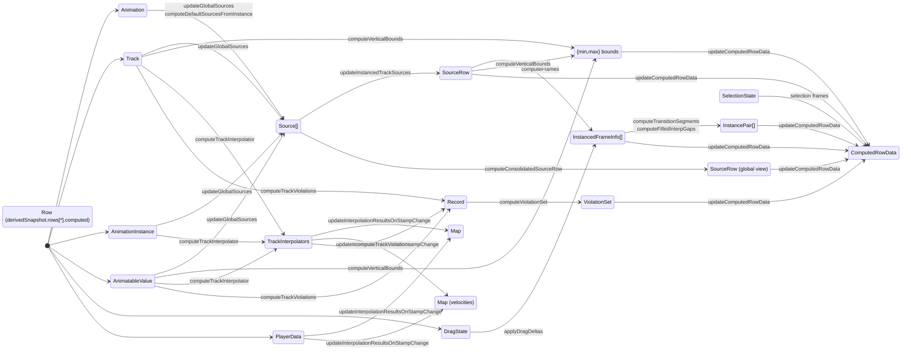

# @semio/animation Documentation

`@semio/animation` supplies the shared animation timeline, selection, and gesture system used across Semio surfaces. The package exposes React components (timeline HUD, track controls, playback widgets), the zustand store that powers them, helper actions for manipulating animation data, and a suite of utilities for rendering and validating animated motion.

This docs folder intentionally contains only this README, plus temporary tracking documents when migration work is active. Keep working notes in issues/PRs or project tracking, and update this file when behavior or data shape changes.

## Active Tracking

- `migration-tracking.md`: Stored animation migration utility + store load path changes (2026-01-28).

## Package Anatomy

| Path | Purpose | Notes |
| --- | --- | --- |
| `src/index.tsx` | Package entry point | Re-exports public components, hooks, store helpers, actions, utilities, and test fixtures. Keep this file authoritative for public API shape. |
| `src/components/` | React components for the animation sheet, controls, HUD, and visualization widgets | Split into focused sub-folders (`animation-sheet`, `controls`, `canvas-sheet`, etc.). Components consume the zustand store via hooks and context. |
| `src/actions/` | Pure Immer reducers mutating `AnimationData` | Includes creation/update/removal of animations, tracks, keypoints, color controls, and drag orchestration (`actions/drag/*`). All mutations flow through these helpers. |
| `src/functions/` | Pure computation helpers and derived data builders | Houses frame interpolation, source-tree management, drag math, virtual frame generation, selection-state helpers, and rendering-specific transforms. |
| `src/hooks/` | React hooks for interacting with the store, gestures, and rendering primitives | Includes gesture bindings (`use-drag-gestures`, `use-zoom-gestures`), spring helpers, player integration, and selectors (`use-animation-store`). |
| `src/subscriptions/` | Store subscriptions registered at init | Maintain derived state (interpolators, computed rows, global sources), synchronize with the shared player store, and clean up via unsubscribe handles. |
| `src/store.ts` | zustand store slice factory | Composes `AnimationData` state with `AnimationActions`, wires Immer-based updates, and bootstraps subscriptions. |
| `src/store-types.ts` | Canonical types for store state and actions | Documented source of truth for the data model. Update alongside behaviour changes. |
| `src/types/` | Domain types for animations, sources, views, and drag state | Structured by `data/` and `util/` folders; heavily referenced by consumer apps. |
| `src/test-fixtures/` | Reusable sample animations/tracks | Use these when adding Vitest coverage or Storybook scenarios. |
| `src/tests/` | Vitest suites | Test reducers, derived data helpers, and drag behavior. Some suites remain skipped for debugging scenarios. |
| `docs/` | Package documentation | This README only. |

## Core Concepts & Assumptions

- Canonical state lives in `AnimationData` (animations, tracks, instances, selection, `dragState`, preferences). Derived state is computed and published to `derivedSnapshot` with a monotonic `version` for consistent UI reads.
- `selectionState` is keyed by track id -> keypoint ids and scoped to a single instance id. Selection helpers operate on row-foreground keypoints; prefer derived snapshot frames/render markers for selection UI, but some gating still reads `selectionState.keypoints` during migration.
- Transition handles use two representations:
  - `TransitionInfo.in/out` may be a `StandardTransitionType` enum (easing) or an explicit `RawVector2` delta.
  - Missing transitions resolve to `StandardTransitionType.Cubic`. Missing/enum transitions render as empty handles; explicit deltas render as filled handles.
- Transition track render normalizes control points to the current segment value delta, then rescales when explicit handles overshoot so the curve stays within the track (endpoints may no longer sit at 0/1 in those cases). Explicit handle deltas live in value space, so moving a keypoint can change the transition curve even when handle deltas are unchanged.
- Marker drags preserve handle world positions using `dragState.markerHandleOffsets`. Only explicit handles are rewritten during preview/commit; missing transitions are promoted to cubic easing enums for selected points.
- Handle drags are driven by UI-supplied `handleDeltas` (data-space deltas) and stored in `dragState.handleDiffs`. Paired handles preserve view-space length unless the user forces mirrored lengths.
- Value drags use literal row bounds (`verticalBounds`) and ignore spline view padding/offset; the UI normalizes to those bounds before updating the drag state.

## Core Data Model

The zustand store (`AnimationData` in `store-types.ts`) is the single source of truth for canonical data. A normalized derived snapshot is produced by the orchestrator for rendering. Key fields:

- `values` / `velocities`: `Map<string, RawValue>` keyed by `${namespaceId}/${instanceId}/${trackId}` describing the sampled value/velocity at the current stamp. Use `buildTrackKey` for lookups. Derived updates merge into the existing map so downstream apps can retain additional keys (for example, scene-side dot-namespace values).
- `tracks`: Scalar `SimpleTrack` records after flattening composite animatables into per-component tracks.
- `namespaces`: Namespaced animation instances keyed by ID. Encodes instance/group relationships so overlapping tracks do not stomp each other.
- `animations` / `tracks`: Canonical animation metadata (`StoredAnimation` + `Track<RawValue>`) loaded in the editor. Tracks reference keypoints and interpolator configuration.
- `selectionState`: Path-based selection record managed via `functions/selection-state-manager.ts`.
- `previews`: Semantic time markers (`Preview`) for scrubbers, hover, etc.
- `dragState`: Structure describing in-progress virtual drag operations, including original keypoint positions, handle offsets, and handle diffs.
- `editorViews`: Multi-window configuration (see `types/util/view.ts`) capturing view mode, active source rows, and layout preferences.
- `sourcesByAnimationInstance` / `instancedTrackSources`: Hierarchical representation of animation data grouped by animation, namespace, and instance. Per-entity muting lives on `SourceTrack.muted` (namespace-scoped), not on shared track settings.
- `sourceRowIds`: Base row visibility derived from source expansion (no per-view hiding).
- `sourceRowIdsByView`: View-specific row visibility derived from `View.hiddenSourceTrackIds`; this drives track/canvas rendering and per-view filtered global rows.
- `preferences`: UI toggles (hover dashed line, data previews) synced with consuming apps.
- `derivedSnapshot`: Normalized view (track cache feeding row/selection views) including per-track caches, `rows`, and precomputed aggregates used by the UI and Storybook during both steady state and drag preview.
- `derivedSnapshot.version`: Monotonic version bumped by the derived-state orchestrator; selectors should subscribe to this to avoid stale reads.

## Index-Free Stored-Shape Migration (Proposal)

Not implemented. This outlines a possible migration if canonical state keeps the stored animation shape (tracks nested on each animation) and removes the global `AnimationData.tracks` map. The goal is to avoid persistent track back-references while carrying `animationId` forward through derived views.

- **Goal:** Keep `AnimationData.animations` in stored shape (`tracks: Track[]`) and drop `AnimationData.tracks`, relying on `animationId` carried through `SourceRowData`/frames instead of global indices.
- **Types + store:** Collapse `Animation`/`StoredAnimation` (or add `AnimationDocument`) so canonical animations own `tracks: Track[]`; replace `tracksRevision` with an `animationsRevision` or per-animation revision bump.
- **Normalization (migration vs load):** Split `normalizeTrackData` into `normalizeStoredAnimation` (per animation) that only flattens composite tracks and updates animatables; `addAnimation`, `setAnimations`, and `createAnimationStore` call this and store the result directly.
- **Actions:** Update track/keypoint actions to take `animationId` (for example, `updateKeypoint(animationId, trackId, ...)`); add a helper that finds tracks within `animation.tracks` by id; update callers that already know `animationId` (ControlWidget, value actions, drag start inputs).
- **Selection + drag state:** Extend selection/drag anchors to include `animationId`; store selected keypoints by `{animationId, trackId}` so lookups avoid scanning all animations; seed `animationId` from `SourceRowData.animationId` or `InstancedFrameInfo`.
- **Derived snapshot + sources:** Change `computeDefaultSourcesFromInstance`, `groupDerivedTracks`, `computeRowData`, and `buildDerivedSnapshot` to accept `animation.tracks` arrays and use `animationId` + `trackId` from `SourceRowData`; build ephemeral per-animation lookup maps inside these functions if needed for speed (not stored in state).
- **Serialization:** `getStorableAnimation` becomes a thin cleanup (strip muted, normalize settings), since stored shape is canonical; no track-map conversion needed.
- **Studio integration:** Adjust Studio `values-actions` and temporal store partialization to read/write nested `animations[animationId].tracks` and pass `animationId` through action APIs.
- **Tests/fixtures:** Update test fixtures/helpers that assume `state.tracks` to pull from `animation.tracks` and pass `animationId` everywhere.

### File-by-File Checklist (Index-Free)

- `packages/animation/src/types/data/animation.ts`: change canonical animation to own nested tracks and remove `StoredAnimation`. New type: `export interface AnimationDocument { id: string; name: string; tracks: Track<RawValue>[]; groups: TrackGroup[]; duration: number; }` (or reuse `Animation` with that shape). Source for `animationId`: persistence layer and in-memory `state.animations`.
- `packages/animation/src/types/data/track.ts`: remove or alias `StoredTrack` so `Track` is the stored+runtime shape. New type: `export interface Track<DataType extends RawValue> { id: string; name: string; groupName?: string; points: Keypoint<DataType>[]; animatableId: string; settings?: { color?: string; muted?: boolean } }`. Source: `AnimationDocument.tracks`.
- `packages/animation/src/store-types.ts`: drop `tracks: Record<string, SimpleTrack>` and `tracksRevision`; add `animationsRevision?: number`. New action signatures: `addAnimation(animation: AnimationDocument): void`, `setAnimations(animations: Record<string, AnimationDocument>): void`, `createTrack(animatableId: string, animationId: string, track: Partial<SimpleTrack>): SimpleTrack`, `updateTrack(animationId: string, track: Partial<SimpleTrack> & { id: string }): void`, `updateTrackGroupName(animationId: string, trackIds: string[], name: string): void`, `removeTrack(animationId: string, trackId: string): void`, `createKeypoint(animationId: string, trackId: string, point: Partial<SimpleKeypoint>): SimpleKeypoint`, `createKeypoints(keypoints: { animationId: string; trackId: string; keypoint: Partial<SimpleKeypoint> }[]): void`, `updateKeypoint(animationId: string, trackId: string, keypoint: Partial<SimpleKeypoint> | KeypointDelta<SimpleRawValue>, canMerge?: boolean): SimpleKeypoint | undefined`, `updateKeypoints(keypoints: { animationId: string; trackId: string; keypoint: Partial<SimpleKeypoint> }[], canMerge?: boolean): void`, `removeKeypoint(animationId: string, trackId: string, keypointId: string): void`, `removeKeypoints(keypoints: { animationId: string; trackId: string; keypointId: string }[]): void`, `insertKeypointAtWorldStamp(animationId: string, trackId: string, worldStamp: number, instanceId: string): SimpleKeypoint | undefined`. Likely source: `SourceRowData.animationId` or `RenderMarker.animationId` from derived rows; fallback via `selectionState.instanceId -> namespaces`.
- `packages/animation/src/actions/create-default-state.ts`: remove `tracks: {}` and `tracksRevision`; initialize `animationsRevision: 0` if added. No signature changes.
- `packages/animation/src/store.ts`: remove `setTracks`; update `addAnimation`, `setAnimations`, `createTrack`, `updateTrack`, `removeTrack`, `updateTrackGroupName`, and `getStorableAnimation` to use `state.animations[animationId].tracks`; replace `tracksRevision` increments with `animationsRevision`. Public signatures should match the `store-types.ts` updates; `animationId` should come from row data (`SourceRowData.animationId`) or `selectionState.instanceId` lookup.
- `packages/animation/src/actions/add-animation.ts`: new signature `addAnimation(state: AnimationData, animation: AnimationDocument): void`; normalize per animation and assign `state.animations[animation.id] = normalized`. Source: persisted animation document.
- `packages/animation/src/actions/remove-animation.ts`: new signature `removeAnimation(state: AnimationData, animationId: string): void` (drop `removeTracks`); delete `state.animations[animationId]` only.
- `packages/animation/src/actions/create-track.ts`: signature stays `createTrack(state, animatableId, animationId, track)` but must push into `state.animations[animationId].tracks` and return the created track; `animationId` comes from UI row context.
- `packages/animation/src/actions/update-track.ts`: new signature `updateTrack(state: AnimationData, animationId: string, track: Partial<SimpleTrack> & { id: string }): void`; locate `animation.tracks` by id and merge. Source: `SourceRowData.animationId` and the track id.
- `packages/animation/src/actions/remove-track.ts`: signature `removeTrack(state: AnimationData, animationId: string, trackId: string): void`; remove from `animation.tracks` and prune any groups referencing the track. Source: row/instance context.
- `packages/animation/src/actions/update-keypoint.ts`: new signature `updateKeypoint(state: AnimationData, animationId: string, trackId: string, keypoint: Partial<SimpleKeypoint> | KeypointDelta<SimpleRawValue>, canMerge?: boolean): SimpleKeypoint | undefined`; resolve track via `state.animations[animationId].tracks`. Source: row/marker context (`SourceRowData.animationId` or `RenderMarker.animationId`).
- `packages/animation/src/actions/create-keypoint.ts`: new signature `createKeypoint(state: AnimationData, animationId: string, trackId: string, point: Partial<SimpleKeypoint>): SimpleKeypoint`; resolve nested track. Source: row/marker context.
- `packages/animation/src/actions/remove-keypoint.ts`: new signature `removeKeypoint(state: AnimationData, animationId: string, trackId: string, keypointId: string): void`; resolve nested track. Source: row/marker context.
- `packages/animation/src/actions/insert-keypoint-at-stamp.ts`: new signature `insertKeypointAtWorldStamp(state: AnimationData, animationId: string, trackId: string, worldStamp: number, instanceId: string): SimpleKeypoint | undefined`; resolve nested track; `animationId` comes from `SourceRowData.animationId` or `ValueDragStartInput.animationId`.
- `packages/animation/src/actions/set-track-value.ts`: new signature `setTrackValue(state: AnimationData, animationId: string, trackId: string, value: SimpleRawValue): void`; resolve nested track; `animationId` comes from UI or project context.
- `packages/animation/src/types/util/drag-state.ts`: add `animationId` to `DragAnchorRef`, `insertedKeypoint`, and `handleAnchor`; add `animationId` to `DragStartInput` and `ValueDragStartInput`. Example updates: `DragStartInput { animationId: string; origin: PointerPosition; axis: DragAxis; markerId: string; rowId: string; valueScale?: ValueScale }`, `ValueDragStartInput { animationId: string; rowId: string; trackId: string; namespaceId: string; instanceId: string; worldStamp: number; origin: PointerPosition; valueScale?: ValueScale }`, `HandleDragStartInput { animationId: string; origin: PointerPosition; side: "in" | "out"; rowId: string; trackId: string; keypointId: string; neighborKeypointId: string; ... }`. Likely source: `SourceRowData.animationId` and/or `RenderMarker.animationId`.
- `packages/animation/src/types/util/diff.ts`: add `animationId` to all diff ops and selection cleanup. Example: `UpdateKeypointDiff { type: "updateKeypoint"; animationId: string; trackId: string; keypointId: string; changes: ... }`, `DeleteKeypointDiff { animationId: string; trackId: string; keypointId: string }`, `InsertKeypointDiff { animationId: string; trackId: string; keypoint: ... }`, `ReorderKeypointsDiff { animationId: string; trackId: string; order: string[] }`, `HandleDiff { type: "handle"; animationId: string; trackId: string; keypointId: string; changes: ... }`, `SelectionCleanup { animationId: string; trackId: string; removedIds: string[] }`. Source: `dragState.anchor.animationId` and per-row context.
- `packages/animation/src/types/util/selection-state.ts`: include `animationId` in selection addresses and anchors. Example: `export interface SelectionAnchor { rowId: string; markerId: string; animationId: string; }` and `export interface KeypointAddress { animationId: string; trackId: string; keypointId: string; }`; update `SelectionState.keypoints` to be keyed by `${animationId}/${trackId}` (or `Map<animationId, Map<trackId, Set<keypointId>>>`). Source: `SelectionPointRef.animationId` carried in derived frames.
- `packages/animation/src/types/util/render-types.ts`: add `animationId?: string` to `SelectionPointRef` and `RenderHandle`, and ensure `RenderMarker.animationId` is populated; data should come from `SourceRowData.animationId` during row computation.
- `packages/animation/src/functions/selection-state-manager.ts`: update helper signatures to accept/emit `animationId`; implement a `buildSelectionTrackKey(animationId, trackId)` helper so selection map keys stay consistent. Source: `SelectionPointRef.animationId` from `SelectionFrame` and `RenderMarker.animationId`.
- `packages/animation/src/functions/normalize-track-data.ts`: split into `normalizeStoredAnimation(animation: AnimationDocument, animatables: Record<string, AnimatableValue>): { animation: AnimationDocument; animatables: Record<string, AnimatableValue> }` and any animatable-only helper; normalize per animation instead of across a global track map.
- `packages/animation/src/functions/compute-stored-animation.ts`: new signature `computeStoredAnimation(animation: AnimationDocument): AnimationDocument`; only strip runtime-only settings (e.g. `muted`) since stored shape is canonical.
- `packages/animation/src/functions/group-derived-tracks.ts`: new signature `groupDerivedTracks(tracks: Track<RawValue>[], animatables: Record<string, AnimatableValue>): DerivedTrackGroup[]`; no global track map.
- `packages/animation/src/functions/compute-default-sources-from-instance.ts`: new signature `computeDefaultSourcesFromInstance(namespaceId: string, animationInstance: AnimationInstance, animation: AnimationDocument, animatables: Record<string, AnimatableValue>): Source[]`; use `animation.tracks` directly; `animationId` is `animationInstance.animationId`.
- `packages/animation/src/subscriptions/update-global-sources.ts`: remove `state.tracks` from dependencies; rely on `state.animations` and `animationsRevision` if added; pass `animations[animationId].tracks` into `computeDefaultSourcesFromInstance`.
- `packages/animation/src/subscriptions/update-instanced-track-sources.ts`: replace `tracksRevision` with `animationsRevision`; update `groupDerivedTracks(animation.tracks, animatables)`; use `animationId` from `SourceRowData`.
- `packages/animation/src/subscriptions/update-consolidated-source-row.ts`: ensure any track lookups read from `animation.tracks` using `SourceRowData.animationId`; no `state.tracks` access.
- `packages/animation/src/subscriptions/init-derived-orchestrator.ts`: update input shape so `buildDerivedSnapshot` receives `animations` only; build any local lookups from `state.animations` before invoking.
- `packages/animation/src/functions/build-derived-snapshot.ts`: remove `tracks` param; iterate `animation.tracks` arrays when building `DerivedTrackSnapshot` and violation caches; use `animation.id` in the metadata. Source: `animations` map.
- `packages/animation/src/functions/compute-row-data.ts`: accept a `trackLookup` keyed by `animationId` (built per orchestrator pass) or accept `animations` and resolve tracks via `SourceRowData.animationId`. New signature example: `computeRowData(sourceRow: SourceRow, animations: Record<string, AnimationDocument>, animatables: Record<string, AnimatableValue>, dragState: DragState | undefined, selectionState: SelectionState, ...)`.
- `packages/animation/src/functions/drag-diff-ops.ts`: extend `ComputeDragDiffOpsParams` with `animationId: string`; emit diff ops that include `animationId`. Source: `dragState.anchor.animationId` or explicit param from caller.
- `packages/animation/src/functions/apply-drag-deltas.ts`: update `ApplyDragContext` to include `animationId` or a composite selection key; selection membership should use `${animationId}/${trackId}` when checking `selectionState.keypoints`.
- `packages/animation/src/functions/resolve-dragged-track-ids.ts`: return `Set<string>` keyed as `${animationId}/${trackId}` (or a `TrackRef` list) to align with selection map; source data from `dragState.trackSnapshots`, `selectionState.keypoints`, and `dragState.anchor.animationId`.
- `packages/animation/src/actions/drag/start-drag.ts`: new input shape `startDrag(state, input: DragStartInput)` where `input.animationId` is required; set `dragState.anchor.animationId` and use it to resolve the track inside `state.animations[animationId].tracks`. Source: `RenderMarker.animationId` or `SourceRowData.animationId`.
- `packages/animation/src/actions/drag/update-drag.ts`: use `dragState.anchor.animationId` to resolve tracks and compute diffs; no global `state.tracks` access.
- `packages/animation/src/actions/drag/value-drag.ts`: new input `ValueDragStartInput` includes `animationId`; store `dragState.insertedKeypoint = { animationId, trackId, keypointId }`; resolve track via `state.animations[animationId].tracks`. Source: `SourceRowData.animationId`.
- `packages/animation/src/actions/drag/start-handle-drag.ts`: new input `HandleDragStartInput` includes `animationId`; store `dragState.handleAnchor.animationId` and use it for track lookup. Source: `RenderHandle.animationId` or row data.
- `packages/animation/src/actions/drag/update-handle-drag.ts`: ensure `handleDiffs` carry `{ animationId, trackId }` so commit does not scan all animations; source is `dragState.handleAnchor.animationId`.
- `packages/animation/src/actions/drag/commit-drag.ts`: apply diffs by `animationId` + `trackId`; update any scan-based fallback to use the embedded `animationId`.
- `packages/animation/src/components/canvas-sheet/data-point.tsx`: include `animationId` in `startDrag` input; source from `computedRowData.virtualFrames[*].points[*].animationId` (if added) or from `sourceRow.data` passed into the component.
- `packages/animation/src/components/canvas-sheet/bezier-handles.tsx`: include `animationId` in `startHandleDrag`; source from `RenderHandle.animationId` or the row's `SourceRowData.animationId`.
- `packages/animation/src/components/animatable-editor.tsx`: pass `animationId` to `startValueDrag` and `updateTrack`; resolve `track` from `state.animations[data.animationId].tracks` instead of `state.tracks`.
- `packages/animation/src/components/control-widget.tsx`: pass `animationId` into `updateKeypoints`, `removeKeypoints`, `insertKeypointAtWorldStamp`, `updateTrackGroupName`; derive it from `sourceRow.data` and thread into update payloads.
- `packages/animation/src/components/timeline-control.tsx`: update any `updateKeypoints` calls to include `animationId` for each payload; source from row data.
- `packages/animation/src/hooks/use-track-animatables.tsx`: rebuild lookup from `state.animations` by iterating nested `tracks`; new signatures should accept `animationId` + `trackId` (or key by `${animationId}/${trackId}`) to avoid global track maps.
- `packages/animation/src/hooks/use-colors.tsx`: compute track colors from nested tracks; update `useColors` to accept composite keys or `animationId` + `trackId`. Source: `state.animations` + `animatables`.
- `packages/animation/src/hooks/use-names.tsx`: mirror `use-colors` changes for name lookup; source is nested tracks plus animatables.
- `packages/animation/src/tests/**`: update all action call sites to include `animationId` and update any direct `state.tracks` access to resolve from `state.animations[animationId].tracks`.
- `packages/animation/src/test-fixtures/**`: restructure fixtures so each animation owns its `tracks` array; remove separate track map setup.
- `apps/studio/src/store/actions/values-actions.ts`: update calls to `updateKeypoint(state, animationId, trackId, ...)` and track lookup to use `state.animations[animationId].tracks`; `animationId` already derived from entity driver.
- `apps/studio/src/hooks/store.ts`: update temporal `partialize` to remove `tracks` and persist nested tracks inside `animations`; adjust any restore logic accordingly.
- `apps/docs/stories/prebuilt/animation.ts`: update story fixtures to create `animations` with nested `tracks` arrays and remove `tracks` map construction.

## Derived Snapshot & Orchestrator

Schema overview:
- TrackKey: stable identifier that uniquely addresses a track within an animation instance/namespace.
- DerivedTrack: per-track cache including interpolator references, last-computed frames, and violation summaries.
- DerivedRow: UI row projection containing sources, instanced frames, transition segments, vertical bounds, and computed aggregates used by controls and canvas.
- DerivedSnapshot: `{ tracks, rows, version, dragContext?, dragOverlay?, renderSampleCache? }` produced atomically by the orchestrator.

Computation phases:
- Inputs: global/instanced sources and canonical track metadata.
- Build/refresh per-track interpolators and caches.
- Compute per-row frames, bounds, transition pairs, and consolidated/global rows.
- Assemble the snapshot and publish by bumping `derivedSnapshot.version`.

## Actions & Mutations

All state changes flow through the `src/actions` layer. Notable groups:

- **Animation lifecycle**: `addAnimation`, `removeAnimation`, `createNewDefaultAnimation`, `setAnimations`, `getStorableAnimation` (with serialization logic in `functions/compute-stored-animation.ts`).
- **Track & keypoint editing**: `createTrack`, `updateTrack`, `removeTrack`, `createKeypoint`, `updateKeypoint`, `removeKeypoint`, plus batch variants for multi-edit operations.
- **Selection & gestures**: `clickMarker`, `clickLine`, `clearSelection`, and `focusSelectionInstance` coordinate modifier-key behavior and tie into the selection state.
- **Drag orchestration**:
  - Marker drags: `startDrag` → `updateDrag` → `commitDrag` / `cancelDrag`.
  - Value drags: `startValueDrag` → `updateValueDrag` → `commitValueDrag` / `cancelValueDrag`.
  - Handle drags: `startHandleDrag` → `updateHandleDrag` → `commitDrag` / `cancelDrag`.
  - Track-key value writes use `setTrackValue` (not `setValue`) to avoid collisions with scene-level setters in consuming apps.

Each action assumes Immer-managed drafts—pass the zustand state into the helper instead of mutating directly.

### Event Timeline (Drag → Commit)

During drag (preview):
- Start actions seed `dragState`; marker/value drags capture snapshots/offsets, value drags may insert a keypoint (tracked via `dragState.insertedKeypoint`), and handle drags seed `handleAnchor` + `handleDiffs`.
- Update actions mutate `dragState` only; canonical tracks/keys are not mutated apart from the provisional insertion in `startValueDrag`.
- The derived orchestrator recomputes preview projections (frames, bounds, transition segments, computed row data) and interpolators as needed, publishing a new `derivedSnapshot`.

On commit:
- Apply offsets/diffs to canonical keypoints/tracks in `animations`/`tracks`.
- Clear `dragState` and trigger a full orchestrator pass so interpolators, values/velocities, violations, and row computations align with the committed state.

## Rendering Surface

- `AnimationSheet` / `AnimationSheetCore` compose the timeline UI (headers, controls, track list, canvas).
- `ControlWidget`, `KeyStrip`, and the `controls/` subtree power the HUD and inspector.
- `canvas-sheet/` contains Three.js powered visualizations, pairing with gesture hooks for pan/zoom.
- Components rely on `AnimationContext` + `useAnimationStore` to bind to store slices; avoid re-exporting raw store handles from components.
- Storybook stories live in `apps/docs/stories` under the `Animation/` namespace. Group new stories by package name so the centralized docs stay organized.

## Gestures & Springs

Hooks under `src/hooks` wrap `@use-gesture/react` and custom math helpers to provide:

- Drag/zoom gestures (`use-drag-gestures`).
- Positioning and rendering springs (`use-hover-spring`, `use-playhead-spring`, `use-invariant-scale`).
- Context helpers (`use-names`, `use-colors`, `use-track-animatables`).
- Camera setup for Three.js scenes (`use-ortho-camera-setup`).

Use these hooks rather than inlining gesture logic inside components; they encapsulate the ID-based selection system and store mutations.

## Testing & Fixtures

- Vitest suites in `src/tests` cover reducers, derived data helpers, and drag behavior. Some debug suites remain skipped; keep new tests aligned with the existing fixtures and store helpers.
- Fixtures in `src/test-fixtures` provide deterministic animations/tracks. Reuse them in tests and Storybook to keep scenarios consistent.

## Editor MVP Checklist

Current status snapshot kept here to avoid separate working docs:

- [X] Correct interpolation methods (cubic-bezier + transition settings)
- [ ] Full handle support
  - [X] Handles on Bezier curves
  - [ ] Hotkey to reset handles to flat
  - [X] Key addition in mid-transitions (use a tangent calculation)
- [ ] Selection
  - [X] Single selection
  - [X] Multi selection (Shift + Click, CTRL + Click)
  - [ ] Box selection (Click + Drag) (?)
- [ ] Move selected keyframes (Click + Drag)
  - [X] Click + Drag
  - [ ] Mode switching with T or G keys (plus X/Y)
- [ ] Cut/Copy/Paste keyframes (CTRL + X, CTRL + C, CTRL + V)
- [ ] Locking specific tracks/splines
- [ ] Show/Hide of individual tracks (specific visual depending on TrackRender mode)
- [ ] Scaling when multiple keyframes are selected (with S keybinding)

## Data Flow Overview

