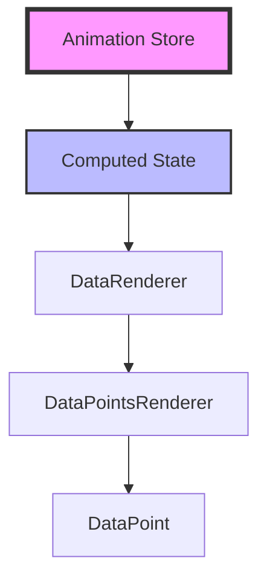

# Phase 2+ Implementation Preparation Guide

## Overview

Phase 2 represents a fundamental shift in our animation architecture, moving from component-based computation to store-based reactive state management. This guide outlines the preparation steps needed before beginning the implementation.

## Current Issues to Be Resolved

### Critical Bug: Marker Selection After Drag
- **Symptom**: Last selected marker in multi-selection cannot be reselected after drag
- **Root Cause**: DataPoint components hold stale `data` props after store updates
- **Test Case**: `src/tests/bug-fixes/marker-reselection-after-drag.test.ts`
- **Browser Test**: `src/tests/browser/marker-drag-selection-issue.browser.test.tsx`

### Architectural Issues
1. **Prop Drilling**: Data flows through multiple component layers
2. **Stale References**: Components retain old props after store updates
3. **Duplicated Logic**: Computation happens in both components and store
4. **Performance**: Unnecessary re-renders during drag operations

## Pre-Implementation Checklist

### 1. Code Inventory
Before starting, document all files that will be affected:

- [ ] **Component Files**
  - `src/components/three/canvas-sheet/data-point.tsx` - Will be simplified
  - `src/components/three/canvas-sheet/data-renderer.tsx` - Will use store subscriptions
  - `src/components/three/canvas-sheet/data-points-renderer.tsx` - Will be updated
  
- [ ] **Store Files**
  - `src/store.ts` - Will add computed state
  - `src/store-types.ts` - Will add new interfaces
  - `src/actions/drag/*.ts` - Already implemented, may need adjustments

- [ ] **Function Files**
  - `src/functions/compute-frames.ts` - Move to store
  - `src/functions/compute-virtual-frames.ts` - Integrate with store
  - `src/functions/compute-transition-segments.ts` - Move to store

### 2. Dependency Analysis
Map out dependencies between components and store:



### 3. Test Coverage
Ensure comprehensive test coverage before refactoring:

- [ ] Unit tests for all computation functions
- [ ] Integration tests for drag operations
- [ ] Browser tests for user interactions
- [ ] Performance benchmarks for current implementation

## Implementation Preparation Steps

### Step 1: Create Feature Branch
```bash
git checkout -b feature/phase2-store-computation
```

### Step 2: Set Up Monitoring
Add performance monitoring to track improvements:

```typescript
// Add to store.ts
const performanceMonitor = {
  computationTime: 0,
  renderCount: 0,
  subscriptionCount: 0,
};
```

### Step 3: Create Compatibility Layer
Build a temporary compatibility layer to allow gradual migration:

```typescript
// src/compatibility/store-bridge.ts
export function useComputedFrames(trackIds: string[]) {
  // Initially returns same as current implementation
  // Will be replaced with store subscription
}
```

### Step 4: Document Current Behavior
Create comprehensive documentation of current behavior:
- Screenshot/record current drag behavior
- Document all edge cases
- Note performance metrics

## Migration Strategy

### Phase 2.1: Add Computed State to Store
1. Add `computedTracks` to store
2. Implement computation subscriptions
3. Keep existing component logic

### Phase 2.2: Create Store Selectors
1. Build efficient selectors for computed data
2. Add memoization strategies
3. Test selector performance

### Phase 2.3: Update Components
1. Replace component computations with store selectors
2. Remove prop drilling
3. Update tests

### Phase 2.4: Cleanup
1. Remove old computation logic
2. Remove compatibility layer
3. Update documentation

## Testing Strategy

### Unit Testing
```typescript
describe('Phase 2 Store Computation', () => {
  it('should maintain selection after drag', () => {
    // Test that marker selection bug is fixed
  });
  
  it('should compute frames efficiently', () => {
    // Test performance improvements
  });
});
```

### Integration Testing
- Test drag operations with multiple selections
- Test performance with large datasets
- Test undo/redo functionality

### Browser Testing
- Run `marker-drag-selection-issue.browser.test.tsx`
- Verify all user interactions work correctly
- Check for visual glitches

## Rollback Plan

If issues arise during implementation:

1. **Immediate Rollback**
   ```bash
   git checkout main
   git branch -D feature/phase2-store-computation
   ```

2. **Partial Rollback**
   - Keep store changes, revert component changes
   - Use compatibility layer to bridge old and new

3. **Feature Flag**
   ```typescript
   const USE_STORE_COMPUTATION = process.env.NODE_ENV === 'development';
   ```

## Success Criteria

### Functional Requirements
- [ ] Marker selection bug is fixed
- [ ] All existing tests pass
- [ ] No regression in functionality

### Performance Requirements
- [ ] Computation time reduced by >30%
- [ ] Re-renders reduced by >50%
- [ ] Memory usage stable or improved

### Code Quality
- [ ] Reduced component complexity
- [ ] Clear separation of concerns
- [ ] Improved testability

## Component Migration Guide

### Before (Current Implementation)
```typescript
// DataRenderer.tsx
const frameData = useMemo(() => {
  return computeFrames(tracks);
}, [tracks]);

// Pass as props
<DataPointsRenderer frameData={frameData} />
```

### After (Phase 2+ Implementation)
```typescript
// DataRenderer.tsx
const frameData = useAnimationStore(
  useShallow(state => state.computedTracks[trackId].frames)
);

// Components subscribe directly
<DataPointsRenderer trackId={trackId} />
```

## Key Files to Review

1. **Store Implementation**
   - `src/store.ts` - Main store logic
   - `src/actions/drag/` - Drag actions

2. **Components**
   - `src/components/three/canvas-sheet/data-point.tsx` - Has stale props issue
   - `src/components/three/canvas-sheet/data-renderer.tsx` - Does computation

3. **Tests**
   - `src/tests/bug-fixes/marker-reselection-after-drag.test.ts` - Bug reproduction
   - `src/tests/browser/marker-drag-selection-issue.browser.test.tsx` - Integration test

## Timeline Estimate

- **Preparation**: 1 day
- **Phase 2.1**: 2 days
- **Phase 2.2**: 1 day
- **Phase 2.3**: 2 days
- **Phase 2.4**: 1 day
- **Testing & Bug Fixes**: 2 days

**Total**: 9 days

## Risk Assessment

### High Risk
- Breaking existing drag functionality
- Performance regression in large datasets

### Medium Risk
- Increased memory usage from computed state
- Complex migration process

### Low Risk
- Test coverage gaps
- Documentation updates

## Next Steps

1. Review this document with the team
2. Get approval for timeline and approach
3. Set up monitoring and metrics
4. Create feature branch and begin implementation

## Questions to Answer Before Starting

1. Should we implement feature flags for gradual rollout?
2. What is our performance baseline to measure against?
3. Do we need to maintain backward compatibility?
4. What is the rollback strategy if issues arise in production?

## Related Documentation

- `dragging-architecture-proposal.md` - Overall architecture design
- `migration-checklist.md` - Detailed migration steps
- `known-issues.md` - Current bugs and limitations